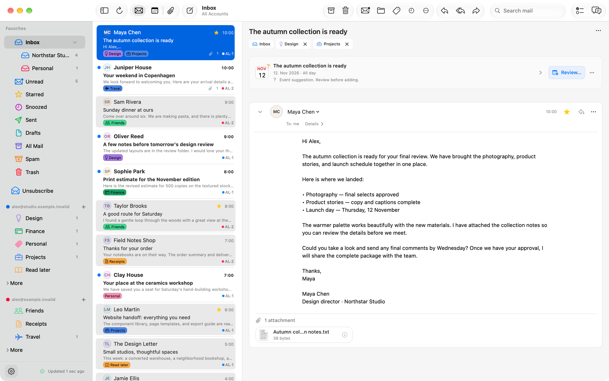
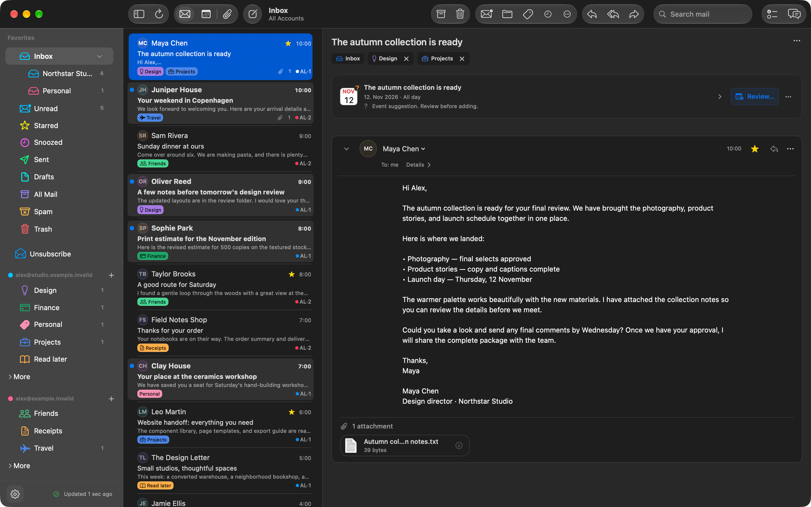
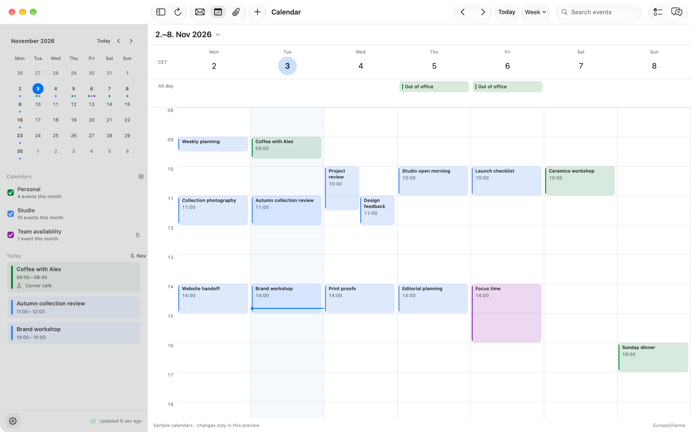
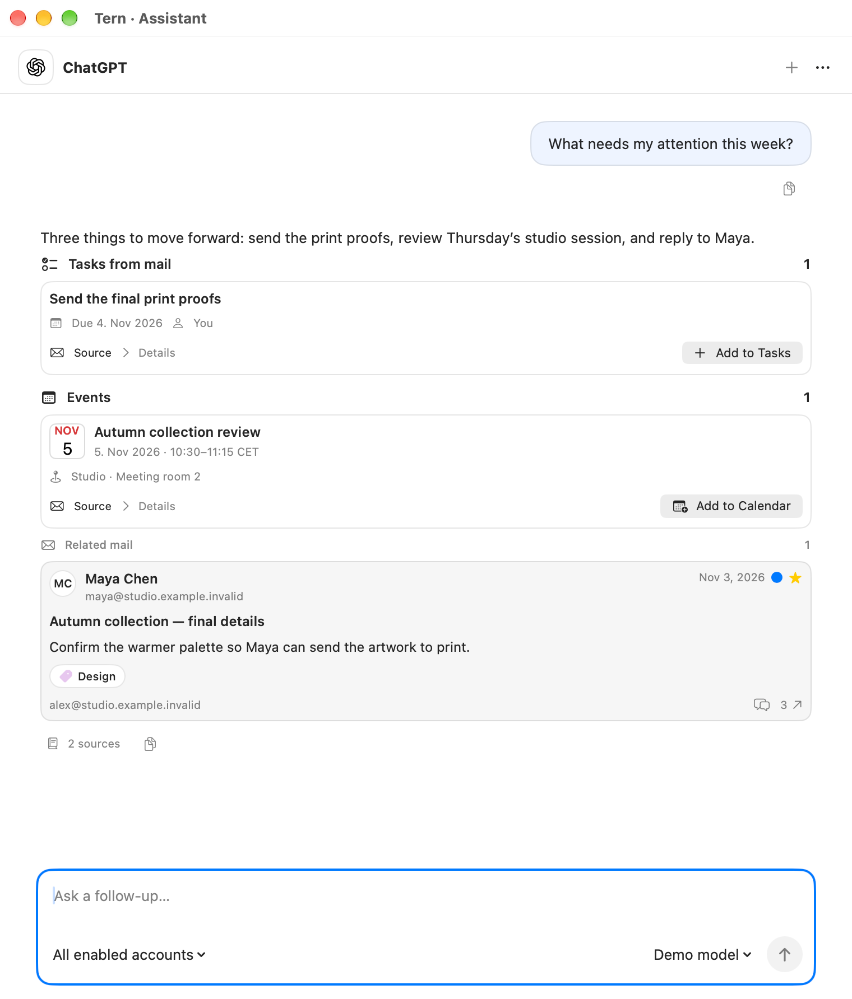
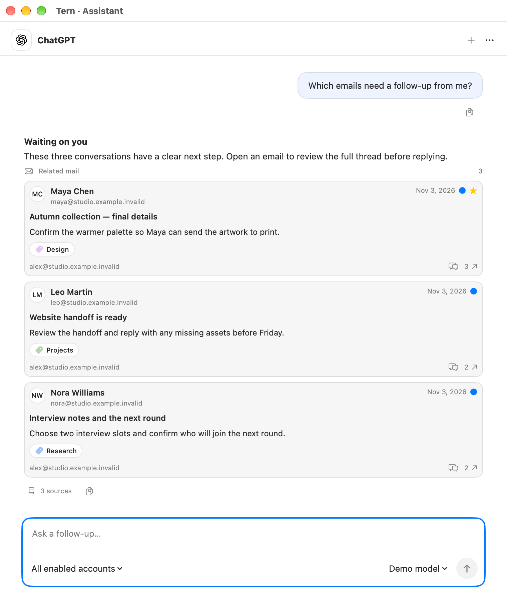
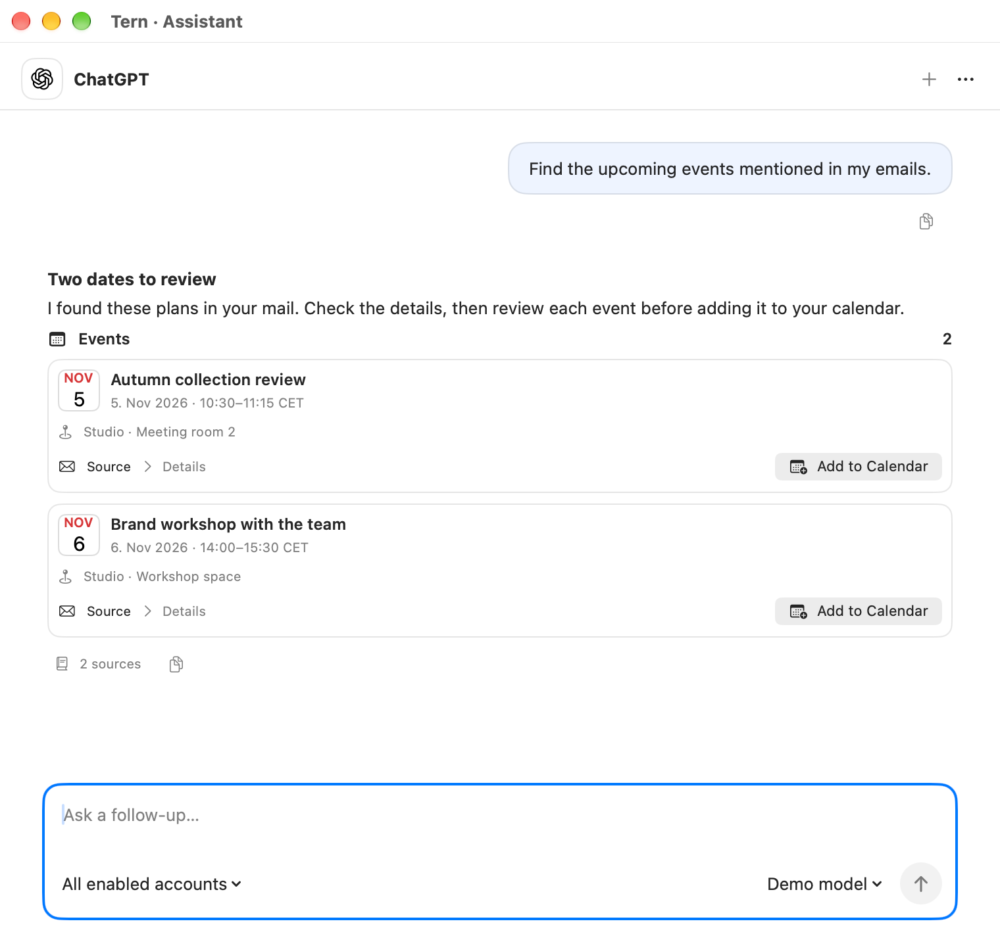
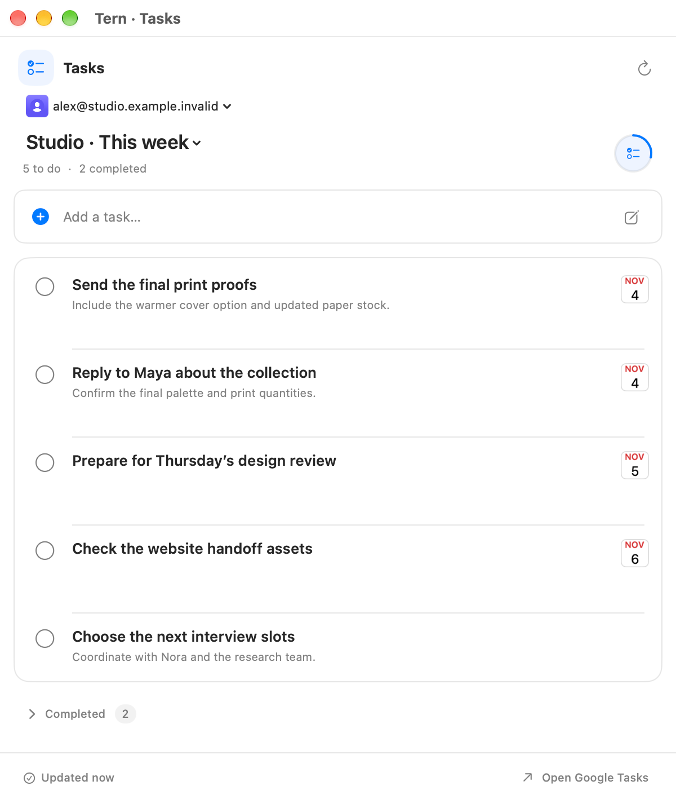

<p align="center">
  
</p>

<h1 align="center">Tern</h1>

<p align="center">Gmail, Calendar, Tasks, and an optional AI assistant in a native Mac app.</p>

<p align="center">
  <a href="#build-from-source">Build from source</a> ·
  <a href="docs/development.md">Development</a> ·
  <a href="#privacy">Privacy</a>
</p>

<p align="center"><sub>macOS 26+ · Swift 6 · Development build</sub></p>



Tern brings your Gmail accounts into a SwiftUI app with a conversation reader, Google Calendar, Google Tasks, and an attachment library. An optional assistant uses ChatGPT, OpenAI API, Claude, or DeepSeek to help you find mail, summarize conversations, and prepare replies.

All screenshots show fictional demo accounts, messages, labels, events, and tasks. Assistant responses are scripted locally for the demo. [Reproduce the screenshots](docs/development.md#screenshots) from the native app.

## Inside the app

| Feature | What you can do |
|---|---|
| Mail | Read across accounts, organize with colored Gmail labels, save searches, pin favorites, and snooze conversations. |
| Compose | Write rich-text replies, attach files, use signatures and templates, and undo a send during the configured delay. |
| Calendar & Tasks | Browse Google calendars, edit events and recurring meetings, and keep Google Tasks beside your mail. |
| Attachments | Find files across accounts and archived mail, filter by type or label, preview with Quick Look, and open the source conversation. |
| Assistant | Search permitted mail, summarize threads, prepare editable replies, and review suggested tasks and events before saving. |
| Organize Mail | Scan up to 100,000 messages for label and rule suggestions that account for your existing labels and rules, then apply the ones you pick to Gmail. |

Native menus, keyboard shortcuts, light and dark appearances, and macOS sharing keep everyday actions close at hand.

## A closer look

<table>
  <tr>
    <td width="50%">
      <a href="docs/screenshots/mail-dark.png"></a>
      <p align="center">Mail in dark mode</p>
    </td>
    <td width="50%">
      <a href="docs/screenshots/calendar.png"></a>
      <p align="center">Google Calendar</p>
    </td>
  </tr>
</table>

## From conversations to next steps

Ask the assistant what needs your attention, see which emails need a reply, and review tasks and events found in your mail. Each suggestion keeps its source conversation close by; you review tasks and events before saving them.

<table>
  <tr>
    <td width="50%" valign="top">
      <a href="docs/screenshots/assistant.png"></a>
      <p align="center">Your assistant, with context from your mail</p>
    </td>
    <td width="50%" valign="top">
      <a href="docs/screenshots/follow-up.png"></a>
      <p align="center">Emails that need a follow-up</p>
    </td>
  </tr>
  <tr>
    <td width="50%" valign="top">
      <a href="docs/screenshots/events.png"></a>
      <p align="center">Events found in your conversations</p>
    </td>
    <td width="50%" valign="top">
      <a href="docs/screenshots/tasks.png"></a>
      <p align="center">Tasks and deadlines beside your mail</p>
    </td>
  </tr>
</table>

## Build from source

You need macOS 26 or later and Xcode 26 or later with Swift 6.2. Google sign-in requires your own OAuth client; the [development guide](docs/development.md#google-sign-in) explains the setup.

```sh
git clone https://github.com/salexandr0s/TernMail.git
cd TernMail
cp Config/Secrets.example.xcconfig Config/Secrets.xcconfig
open Tern.xcodeproj
```

Set `GOOGLE_CLIENT_ID_PREFIX` in `Config/Secrets.xcconfig`, select the **Tern** scheme in Xcode, and run. The app builds without an OAuth client, but Google sign-in stays unavailable until it is configured. Local settings in `Secrets.xcconfig` are ignored by Git.

AI is optional and connects separately in **Settings → Assistant**. Choose ChatGPT sign-in, **Claude (CLI)** through your installed Claude Code, or your own OpenAI, Anthropic, or DeepSeek API key. Claude (CLI) uses the account and billing connected through the official CLI; API keys use the provider's API billing. See the [assistant guide](docs/chatgpt-assistant.md) for setup, models, and access controls.

The Tern scheme also builds and embeds `ClaudeHelper.xpc` for Claude (CLI). This helper runs outside the app sandbox; Tern's main app stays sandboxed. The helper is part of the direct-distribution build, and Claude (CLI) requires the separately installed [official native Claude Code binary](https://code.claude.com/docs/en/setup#install-claude-code). Release builds require a matching Team ID signing identity for the app and helper; see the [assistant's build notes](docs/chatgpt-assistant.md#implementation-references).

## Privacy

Tern stores Google, ChatGPT, and API credentials in macOS Keychain, with separate records for each API provider. Claude Code owns its own sign-in credentials; Tern does not import or store its OAuth tokens. Account data, cached mail, and downloaded attachments are stored locally. Remote message images are blocked by default, and company-logo requests require an explicit choice.

Assistant mail access starts disabled. Once you enable it, relevant content is sent to the selected provider for requests, automatic conversation summaries and event interpretation, and writing-style learning when enabled. Changing providers cancels active work and clears retained assistant context. Calendar access is controlled separately. Review the [assistant's data behavior](docs/chatgpt-assistant.md#chat-controls-and-data) before connecting it.

## Development

The [development guide](docs/development.md) covers builds, tests, signing, and the source layout. Feature details live in the [attachment library](docs/attachment-library.md), [mail organization](docs/mail-organization.md), [contacts](docs/contacts.md), and [design](docs/design/README.md) guides. Read [CLAUDE.md](CLAUDE.md) for repository conventions.
