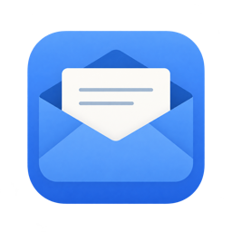
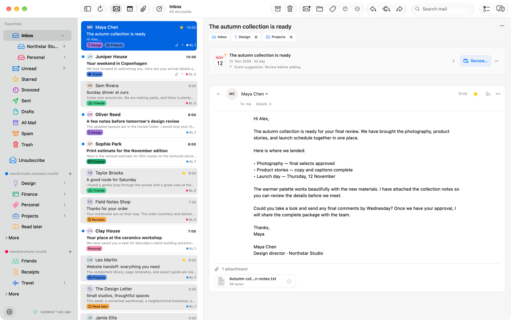
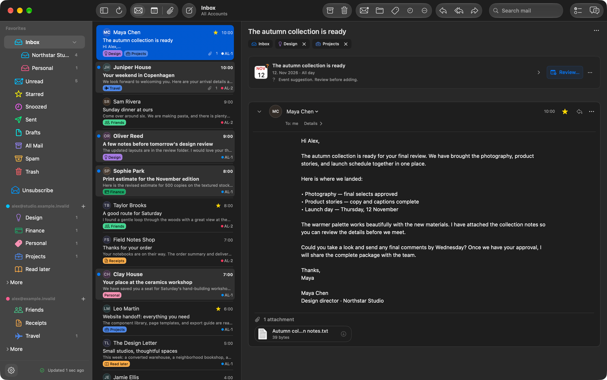
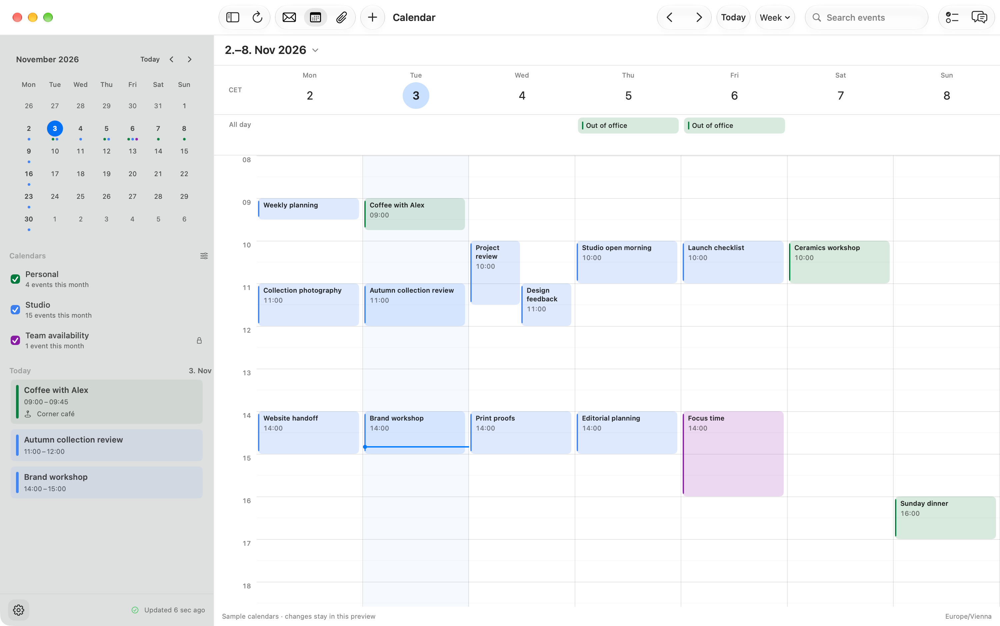

<p align="center">
  
</p>

<h1 align="center">Tern</h1>

<p align="center">Gmail, Calendar, and Tasks in a native Mac app.</p>

<p align="center">
  <a href="#build-from-source">Build from source</a> ·
  <a href="docs/development.md">Development</a> ·
  <a href="#privacy">Privacy</a>
</p>

<p align="center"><sub>macOS 26+ · Swift 6 · Development build</sub></p>



Tern brings your Gmail accounts into a SwiftUI app with a conversation reader, Google Calendar, Google Tasks, and an attachment library. An optional ChatGPT assistant helps you find mail, summarize conversations, and prepare replies.

All screenshots show fictional demo accounts, messages, labels, and events. [Reproduce the screenshots](docs/development.md#screenshots) from the native app.

## Inside the app

| Feature | What you can do |
|---|---|
| Mail | Read across accounts, organize with colored Gmail labels, save searches, pin favorites, and snooze conversations. |
| Compose | Write rich-text replies, attach files, use signatures and templates, and undo a send during the configured delay. |
| Calendar & Tasks | Browse Google calendars, edit events and recurring meetings, and keep Google Tasks beside your mail. |
| Attachments | Find files across accounts and archived mail, filter by type or label, preview with Quick Look, and open the source conversation. |
| Assistant | Search permitted mail, summarize threads, prepare editable replies, and review suggested tasks and events before saving. |
| Organize Mail | Review suggested labels from recent mail, then apply selected labels and optional sender filters to Gmail. |

Native menus, keyboard shortcuts, light and dark appearances, and macOS sharing keep everyday actions close at hand.

## A closer look

<table>
  <tr>
    <td width="50%">
      <a href="docs/screenshots/mail-dark.png"></a>
      <p align="center">Mail in dark mode</p>
    </td>
    <td width="50%">
      <a href="docs/screenshots/calendar.png"></a>
      <p align="center">Google Calendar</p>
    </td>
  </tr>
</table>

## Build from source

You need macOS 26 or later and Xcode 26 or later with Swift 6.2. Google sign-in requires your own OAuth client; the [development guide](docs/development.md#google-sign-in) explains the setup.

```sh
git clone https://github.com/salexandr0s/TernMail.git
cd TernMail
cp Config/Secrets.example.xcconfig Config/Secrets.xcconfig
open Tern.xcodeproj
```

Set `GOOGLE_CLIENT_ID_PREFIX` in `Config/Secrets.xcconfig`, select the **Tern** scheme in Xcode, and run. The app builds without an OAuth client, but Google sign-in stays unavailable until it is configured. Local settings in `Secrets.xcconfig` are ignored by Git.

ChatGPT is optional and connects separately in **Settings → Assistant**. Available models and plan usage depend on the connected ChatGPT account. See the [assistant guide](docs/chatgpt-assistant.md) for access controls and setup.

## Privacy

Google and ChatGPT credentials are stored in macOS Keychain. Account data, cached mail, and downloaded attachments are stored locally. Remote message images are blocked by default, and company-logo requests require an explicit choice.

Assistant mail access starts disabled. Once you enable it, relevant content is sent to OpenAI for requests, automatic conversation summaries and event interpretation, and writing-style learning when enabled. Calendar access is controlled separately. Review the [assistant's data behavior](docs/chatgpt-assistant.md#chat-controls-and-data) before connecting it.

## Development

The [development guide](docs/development.md) covers builds, tests, signing, and the source layout. Feature details live in the [attachment library](docs/attachment-library.md), [mail organization](docs/mail-organization.md), [contacts](docs/contacts.md), and [design](docs/design/README.md) guides. Read [CLAUDE.md](CLAUDE.md) for repository conventions.
